# ComfyUI setup



<!-- Hero from github.com/jefoce/unplatform-ai-provider-node docs/images/hero-dark.svg at ae7ce52. -->

Run local image and video models from ComfyUI. The app talks to ComfyUI through the Unplatform AI node pack over the upai/1 protocol. ComfyUI can run on the same computer or on your local network. These jobs need no OpenRouter key.

| | |
|---|---|
| Time | about 10 minutes |
| Cost | free, your own hardware |
| You need | ComfyUI, the Unplatform AI node pack, one saved workflow |

## What you need

- ComfyUI 0.43.0 or newer.
- The Unplatform AI node pack. In ComfyUI Manager, search "Unplatform AI Provider", install it, then restart ComfyUI.
- Without the registry, clone it into `custom_nodes/unplatform-ai-provider-node`:

```bash
git clone https://github.com/jefoce/unplatform-ai-provider-node \
  custom_nodes/unplatform-ai-provider-node
```

- One or more workflows saved in ComfyUI.
- The ComfyUI port. It is 8188 when ComfyUI runs from source or the portable build. ComfyUI Desktop shows its port in Settings.

## Workflows

The pack ships ready workflows in [workflows](https://github.com/jefoce/unplatform-ai-provider-node/tree/HEAD/workflows). [Build a workflow](https://github.com/jefoce/unplatform-ai-provider-node/blob/HEAD/docs/user/build-a-workflow.md) covers the UPAI nodes, several models in one file and the editor test.

## 1. Save a workflow

Build a workflow with a UPAI Model node, a UPAI Output node, a UPAI Prompt node and a UPAI Settings node, plus the reference, frame, image or audio nodes your model needs. Wire the model path to the output. The app reads reference labels per kind, `image`, `video` and `audio`: `reference_labels.<kind>`, then `reference_label`, then its own default.

Save the workflow. Saving publishes it to the pack. One workflow can hold several model and output pairs, and each pair becomes one model. To publish again without saving, press Publish workflow on the UPAI Model node.

## 2. Add an endpoint

Open Settings in the app and find ComfyUI. Press Add endpoint and fill in:

- Label: any name, shown in Settings.
- Badge: `CU1` and similar. The app assigns the next free number. A deleted number is never reused.
- URL: your ComfyUI address. The pack docs use a base URL ending in `/upai`, for example `http://127.0.0.1:8188/upai`. The app accepts both addresses and drops `/upai`.
- Token: optional. Needed when ComfyUI asks for one.
- Price: see the next section.
- Enabled: keeps the endpoint on or off.

Press Test. A good result lists the protocol, the ComfyUI version, the video and image model counts, LAN access and whether a token is required. Press Save when done.

The app deletes a finished result from ComfyUI after it is safely saved.

## Price modes

| Mode | What it does |
|---|---|
| Use model price | Uses the per run price from the UPAI Model node. |
| Free | Hides the price. |
| Per run $ | Adds the amount once per generation. |
| Per second $ | Multiplies the amount by the video length in seconds. |

A local model with a zero price hides its price. An override shows the amount you set. This is different from an API model, which still shows `$0.00`.

## Model states

- Ready: selectable, Generate works.
- Stale: selectable, but Generate is blocked until you save the workflow again in ComfyUI. The workflow changed after the last export.
- Invalid: disabled, with the reason from ComfyUI.

## Another computer on the network

ComfyUI listens only on this computer by default. Starting it with `--listen 0.0.0.0`, the LAN address, the token and Tailscale are covered in [network](https://github.com/jefoce/unplatform-ai-provider-node/blob/HEAD/docs/user/network.md).

If the computer cannot reach ComfyUI, the app says: This computer cannot reach ComfyUI: enable LAN access in ComfyUI Settings > Unplatform AI, or add a token. Use a trusted network or a tunnel. Never expose ComfyUI directly to the internet.

## VRAM and memory

Per-workflow VRAM and RAM numbers, flags and smaller-file options are in [memory](https://github.com/jefoce/unplatform-ai-provider-node/blob/HEAD/docs/user/memory.md).

## Delete an endpoint

Press Delete on an endpoint. The row is removed at once. Until you press Save, a notice at the bottom of the section says `<badge> removed.` with Undo. When jobs run, it adds `N running jobs will fail when you save.` Save applies it, Cancel restores the row. Running jobs fail with "This endpoint was removed." History keeps the badge and title, so old entries stay readable. No cancel call is sent to ComfyUI.

## Problems

| What you see | What to do |
|---|---|
| Token needed or wrong | Paste the token in the endpoint form, then press Test. |
| This computer cannot reach ComfyUI: enable LAN access in ComfyUI Settings > Unplatform AI, or add a token | Turn on LAN access, add a token, or use the address of this computer. |
| Start ComfyUI, then test again | ComfyUI is closed or the URL has the wrong port. Start ComfyUI and press Test. |
| This server does not speak upai/1 | Install or update the Unplatform AI node pack in ComfyUI, then press Test. |
| ComfyUI upload space is full | Clear ComfyUI input or temp files, then try again. |
| This workflow is gone from ComfyUI. | Save the workflow again in ComfyUI, then refresh the models. |
| Workflow changed in ComfyUI. Save it in ComfyUI, then refresh. | Save the workflow again in ComfyUI, then generate again. |

More answers are in [troubleshooting](https://github.com/jefoce/unplatform-ai-provider-node/blob/HEAD/docs/user/troubleshooting.md) and [FAQ](https://github.com/jefoce/unplatform-ai-provider-node/blob/HEAD/docs/user/faq.md).

## Privacy

Your prompts and reference files go to your own ComfyUI, not to OpenRouter. They stay on your computer or your network. ComfyUI has no login, so the node pack token is the only guard on its routes. Keep ComfyUI on a trusted network.

The [OpenRouter guide](OPENROUTER.md) covers the cloud models.
